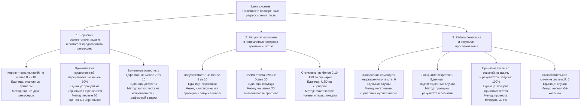

# Лабораторная работа 2. Структура и дерево целей

## Система и цель

Рассматриваемая система — Test Writer: она помогает разработчику или QA
превратить требование либо багрепорт в проверяемый регрессионный тест, запускает
проверки в ограниченной среде и готовит pull request. Решение о принятии и
слиянии остаётся за человеком.

**Цель системы:** помогать команде получать полезные и проверенные регрессионные
тесты, которые связывают исходную задачу с изменением в репозитории и снижают
вероятность повторного появления исправленного дефекта.

Это целевая модель продукта, а не описание уже работающей реализации. По
[границам системы](docs/system-boundary.md), сейчас доступна только HTTP-заглушка;
генерация тестов, интеграции с моделью и запуск в runner ещё не реализованы.

## Декомпозиция по функциям

1. **Принять и уточнить задачу.** Получить требование или багрепорт, выделить
   проверяемое поведение и отметить недостающие данные вместо того, чтобы
   придумывать ожидаемый результат.
2. **Подготовить контекст.** Прочитать только явно разрешённую область
   репозитория и учесть соглашения проекта, не запрашивая несвязанные файлы и
   секреты.
3. **Сформировать сценарий и тест.** Предложить входные данные, ожидаемый
   результат и черновик теста, связанный с исходным поведением.
4. **Проверить предложение.** Проверить структуру и безопасность результата,
   затем запустить тест в изолированной среде и показать фактический статус.
5. **Передать результат и сохранить свидетельства.** Подготовить diff и PR,
   сохранить ссылку на задачу и результаты проверки; оставить принятие и merge
   человеку.

Такое разложение показывает ход работы и места, где нужны решения или проверки:
например, при недостатке сведений следует задать вопрос, а не переходить к
генерации уверенного, но выдуманного теста.

## Декомпозиция по составу

1. **Приём задачи и оркестрация** — принимает описание и область работы,
   управляет этапами сценария.
2. **Адаптер репозитория** — читает разрешённый контекст и подготавливает
   изменения в выбранной области.
3. **Формирование запроса и адаптер модели** — передаёт ограниченный контекст
   выбранной модели и получает ответ.
4. **Валидатор результата** — проверяет формат, полноту, происхождение
   утверждений и небезопасные инструкции.
5. **Политика запуска и изолированный runner** — запускает проверки с
   ограничениями и возвращает статус и ошибки.
6. **Подготовка PR и трассировка** — связывает задачу, diff, запуск и решение
   ревьюера; Git-хостинг и сам ревьюер остаются внешними участниками системы.

Это разложение показывает внутренние границы ответственности и зависимости от
внешней среды: модели, Git-хостинга, runner и человека. Например, сбой runner —
не то же самое, что некорректный тест, а передача PR не означает его принятия.

**Сравнение.** Функциональная декомпозиция отвечает на вопрос «что система
должна сделать и в каком порядке»; на ней заметны уточнение неоднозначности,
проверка результата и передача решения человеку. Декомпозиция по составу
отвечает на вопрос «какие части и границы нужны для этого»; на ней заметны
адаптеры, runner и внешние зависимости. Если смотреть только на функции, легко
не заметить, где заканчивается система и начинаются провайдер или Git-хостинг.
Если смотреть только на состав, можно перечислить компоненты, но упустить
необходимое поведение при неполном или опасном входе.

## Дерево целей

Целевые пороги ниже предварительные: они взяты из [критериев успеха](docs/quality/success-criteria.md)
и [PRD](docs/prd.md), не подтверждены интервью и не являются результатами
экспериментов. Листья остановлены на уровне, для которого можно назвать
показатель, единицу и способ получения числа.

Остановились на этих листьях, потому что для каждого уже заданы наблюдаемые
свидетельства и способ подсчёта. Дальше можно уточнять процедуру измерения —
например, согласовать, что считается существенной переработкой, — но дробить
цели до отдельных действий пользователя или технических шагов пока не нужно:
они сами по себе не доказывают достижение цели системы.

## Конфликт целей и текущий компромисс

Конфликтуют **скорость ответа** и **достоверность и безопасность проверки**.
Сокращение контекста, отказ от запуска теста или пропуск проверок могут снизить
задержку и стоимость, но повышают риск неверного теста или ложного впечатления,
что поведение проверено. В обратную сторону, более полный анализ и запуск в
изоляции требуют времени и ресурсов. Компромисс проекта: безопасность и запуск
не обмениваются на скорость; если runner недоступен, система должна явно сообщить,
что тест не запускался. Целевой p95 в 30 секунд и цена до 0,10 USD за сценарий
пока являются проверяемыми гипотезами.

Сегодня решение в целевом процессе принимает разработчик/QA при ревью PR, а
ограничения безопасности задаёт команда. Автоматического merge быть не должно.
При этом реальные участники команды ещё не назначены, поэтому формального
владельца этого компромисса пока нет; это следует подтвердить и распределить на
интервью.

## Какая ветка проседает

Сейчас слабее всего ветка **«результат исполним и подтверждён проверкой»**, а
также связанная с ней эмпирическая оценка полезности. Это не вывод о низком
качестве уже сгенерированных тестов: таких результатов пока нет. Основание — в
[README](README.md) зафиксирована HTTP-заглушка, а [протокол первой пробы](docs/experiments/lab1.md)
сообщает, что вызовы модели ещё не проводились; согласно [границам системы](docs/system-boundary.md),
интеграции и runner также не реализованы. Значит, для качества и запуска сейчас
нет наблюдений (N = 0), а не подтверждённый провал метрик. Следующий шаг для
проверки ветки — реализовать безопасный запуск, провести пробы на эталонных
примерах и зафиксировать результаты по указанным знаменателям.

## Вопросы приёмки

- **Как узнать, что цель достигнута и где взять число?** По каждому листу дерева
  есть конкретный источник: решения ревьюера, эталонные примеры, запуск тестов,
  измерение времени и токенов, либо журнал безопасности и PR. Пороги пока
  предварительные; сначала нужно получить фактические данные.
- **Что произойдёт, если довести только левую ветку (полезность черновика) до
  предела?** Можно повысить принятие и покрытие задач, но без безопасного запуска,
  ограничений по стоимости и прослеживаемости это может создать дорогие,
  недоказанные или небезопасные изменения. Поэтому остальные ветки — реальные
  ограничения, а не необязательные улучшения.
- **Почему дерево не углублено дальше?** У листьев есть показатель, единица
  измерения и способ получения значения. Следующий уровень описывал бы скорее
  отдельные операции или причины, а не более измеримую цель; к нему стоит
  переходить, если измерение выявит конкретную проблему.