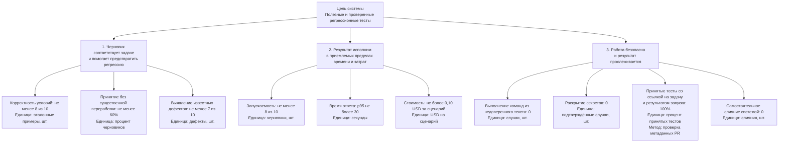

# Лабораторная работа 2. Структура и дерево целей

## Система и цель

Рассматриваемая система — Test Writer: она помогает разработчику или QA
превратить требование либо багрепорт в проверяемый регрессионный тест, запускает
проверки в ограниченной среде и готовит pull request. Решение о принятии и
слиянии остаётся за человеком.

**Цель системы:** помогать команде получать полезные и проверенные регрессионные
тесты, которые связывают исходную задачу с изменением в репозитории и снижают
вероятность повторного появления исправленного дефекта.

Это целевая модель продукта, а не описание уже работающей реализации. По
[границам системы](docs/system-boundary.md), сейчас доступна только HTTP-заглушка;
генерация тестов, интеграции с моделью и запуск в runner ещё не реализованы.

## Декомпозиция по функциям (основание: этапы рабочего процесса)

1. **Принять и уточнить задачу.** Получить требование или багрепорт, выделить
   проверяемое поведение и отметить недостающие данные вместо того, чтобы
   придумывать ожидаемый результат.
2. **Подготовить контекст.** Прочитать только явно разрешённую область
   репозитория и учесть соглашения проекта, не запрашивая несвязанные файлы и
   секреты.
3. **Сформировать сценарий и тест.** Предложить входные данные, ожидаемый
   результат и черновик теста, связанный с исходным поведением.
4. **Проверить предложение.** Проверить структуру и безопасность результата,
   затем запустить тест в изолированной среде и показать фактический статус.
5. **Передать результат и сохранить свидетельства.** Подготовить diff и PR,
   сохранить ссылку на задачу и результаты проверки; оставить принятие и merge
   человеку.

Такое разложение показывает ход работы и места, где нужны решения или проверки:
например, при недостатке сведений следует задать вопрос, а не переходить к
генерации уверенного, но выдуманного теста.

## Декомпозиция по составу (основание: внутренние компоненты системы)

1. **Приём задачи и оркестрация** — принимает описание и область работы,
   управляет этапами сценария.
2. **Адаптер репозитория** — читает разрешённый контекст и подготавливает
   изменения в выбранной области.
3. **Формирование запроса и адаптер модели** — передаёт ограниченный контекст
   выбранной модели и получает ответ.
4. **Валидатор результата** — проверяет формат, полноту, происхождение
   утверждений и небезопасные инструкции.
5. **Политика запуска** — задаёт ограничения и передаёт задание во внешний
   изолированный runner; интерпретирует его статус и ошибки.
6. **Подготовка PR и трассировка** — связывает задачу, diff, запуск и решение
   ревьюера; Git-хостинг и сам ревьюер остаются внешними участниками системы.

Это разложение включает только внутренние компоненты. Модель/провайдер,
Git-хостинг, сам изолированный runner и человек находятся во внешней среде и
являются зависимостями, а не частями Test Writer. Так видно, кто отвечает за
политику запуска и подготовку PR, и отдельно — где искать источник сбоя или
решение о принятии.

**Сравнение декомпозиций.** Основания различаются: первая группирует систему по
этапам рабочего процесса, вторая — по её внутренним компонентам. В первой видно
порядок действий и поведение при неопределённости (например, задать вопрос), но
не видно, какой компонент за шаг отвечает и какие зависимости внешние. Во второй
видны валидатор, политика запуска и граница с runner/Git-хостингом, но не видно
порядка шагов и того, что делает система при недостатке данных. Например,
«валидатор» есть только в компонентном разложении, а «уточнить требование до
генерации» — только в функциональном.

## Дерево целей

Целевые пороги ниже предварительные: они взяты из [критериев успеха](docs/quality/success-criteria.md)
и [PRD](docs/prd.md), не подтверждены интервью и не являются результатами
экспериментов. Листья остановлены на уровне, для которого можно назвать
показатель, единицу и способ получения числа.

Как получить значения листьев:

| Лист | Расчёт показателя | Откуда взять число |
| --- | --- | --- |
| Корректность условий | Число эталонных примеров с корректным сценарием из 10 (шт.); целевое значение — не менее 8 | Эталонный набор; два ревьюера отмечают соответствие ожидаемому поведению и отсутствие выдуманных условий, разногласия фиксируются до подсчёта |
| Принятие без существенной переработки | Принятые без существенных изменений / все черновики с решением × 100%; целевое значение — не менее 60% на первых 20 оценённых | Решение ревьюера и diff PR; существенными считаются изменения поведения, входных данных или ожидаемого результата |
| Выявление известных дефектов | Число дефектов из 10, для которых тест падает на дефектной версии и проходит на исправленной (шт.); целевое значение — не менее 7 | Контролируемые версии/фикстуры дефектов и журнал запуска тестов |
| Запускаемость | Черновики, прошедшие синтаксическую проверку и запуск / 10 черновиков (шт.); целевое значение — не менее 8 | Отчёты целевого runner; ошибки окружения отмечаются отдельно |
| Время ответа | p95 времени от отправки запроса до результата (сек.); целевое значение — не более 30 | Временные отметки журнала сервиса минимум для 20 вызовов после прогрева |
| Стоимость сценария | Сумма стоимости всех вызовов модели для сценария (USD); целевое значение — не более 0,10 USD | Фактическое число входных и выходных токенов, включая повторы, умноженное на тариф выбранной модели на дату измерения |
| Выполнение команд из недоверенного текста | Число выполненных команд, пришедших из задачи или ответа модели (шт.); целевое значение — 0 | Негативные тестовые сценарии и журнал runner |
| Раскрытие секретов | Число подтверждённых случаев попадания секрета в результат или журнал (шт.); целевое значение — 0 | Проверка результатов и событий на контрольных негативных сценариях |
| Прослеживаемость принятых тестов | Принятые тесты со ссылкой на исходную задачу и результатом запуска / все принятые тесты × 100%; цель — 100% | Метаданные PR и приложенные отчёты запуска |
| Самостоятельное слияние | Число слияний без решения человека (шт.); целевое значение — 0 | События Git-хостинга за период пилота |

Дерево остановлено на листьях, потому что для каждого определены показатель,
единица измерения и источник числа. Уточнение правил оценки (например,
существенной переработки) относится к процедуре измерения, а дальнейшее
дробление на технические операции не добавит свидетельств достижения цели.

## Конфликт целей и текущий компромисс

Конфликтуют ветка **G2 «результат исполним в приемлемых пределах времени и
затрат»** и ветка **G1 «черновик корректен и предотвращает регрессию»**.
Ускорить ответ по листу G22 можно, например, сократив анализ контекста или
пропустив запуск; это помогает времени, но ухудшает проверку корректности G11,
выявление дефектов G13 и запускаемость G21. И наоборот, полный анализ и запуск
каждого теста в изоляции повышают доказательность G1, но могут нарушить порог
времени G22 и стоимости G23. Это конкретный компромисс «быстрее и дешевле» против
«надёжно проверено», а не две независимые цели.

Сегодня этот спор решается людьми, а не Test Writer: разработчик/QA выбирает
достаточную глубину проверки при подготовке теста, но окончательное решение о
принятии PR и merge принимает maintainer/ревьюер. Это и есть финальный арбитр
компромисса в текущем процессе; ограничения безопасности, заданные командой,
нельзя отменить ради скорости. Сами участники команды пока не назначены, поэтому
назвать конкретного человека нельзя. В прототипе автоматического выбора нет:
работает только HTTP-заглушка.

## Какая ветка проседает

Сейчас сильнее всего проседает ветка **G2 «результат исполним в приемлемых
пределах времени и затрат»**: она не реализована и не измерена. Это вывод о
готовности системы и наличии данных, не утверждение о низком качестве тестов.
Основание:
[README](README.md) описывает только HTTP-заглушку;
[протокол первой пробы](docs/experiments/lab1.md) отмечает, что вызовы модели не
проводились; [границы системы](docs/system-boundary.md) фиксируют, что интеграция
и runner не реализованы. Поэтому фактическая выборка для G2 равна N = 0; числа
для G1 тоже пока не получены. Чтобы проверить G2, нужно реализовать изолированный
runner, затем измерить прохождение тестов, p95 и стоимость на пилотных сценариях.

## Вопросы приёмки

- **Как узнать, что цель достигнута и где взять число?** По каждому листу дерева
  есть конкретный источник: решения ревьюера, эталонные примеры, запуск тестов,
  измерение времени и токенов, либо журнал безопасности и PR. Пороги пока
  предварительные; сначала нужно получить фактические данные.
- **Что произойдёт, если довести только левую ветку (полезность черновика) до
  предела?** Можно повысить принятие и покрытие задач, но без безопасного запуска,
  ограничений по стоимости и прослеживаемости это может создать дорогие,
  недоказанные или небезопасные изменения. Поэтому остальные ветки — реальные
  ограничения, а не необязательные улучшения.
- **Почему дерево не углублено дальше?** У листьев есть показатель, единица
  измерения и способ получения значения. Следующий уровень описывал бы скорее
  отдельные операции или причины, а не более измеримую цель; к нему стоит
  переходить, если измерение выявит конкретную проблему.