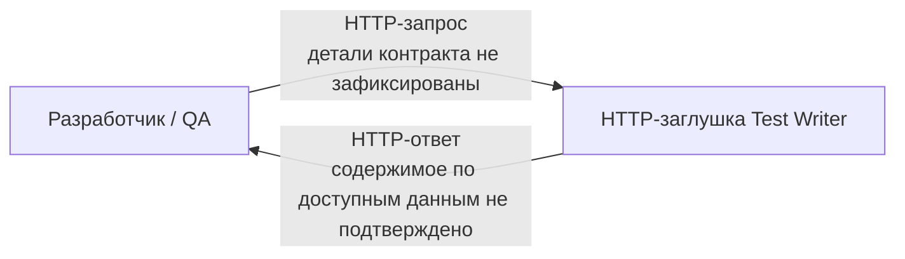

# Лабораторная работа 3. Процесс Test Writer: as-is

## Формулировка задания

**Цель:** описать ключевой процесс системы в нотации и увидеть, чем реальный
ход дел отличается от того, как он записан в регламенте.

Для этого нужно:

1. Выбрать процесс, который в системе повторяется чаще всего и определяет её
   поведение.
2. Найти его официальное описание: регламент, инструкцию, приказ или устную
   договорённость. Если официального описания нет, зафиксировать это.
3. Понаблюдать за фактическим ходом процесса и пройти его от начала до конца
   хотя бы один раз, а лучше — изучить несколько прогонов.
4. Построить модель **as-is** в BPMN или IDEF0, указав участников, шаги,
   развилки и передачи данных между шагами.
5. Отметить расхождения с регламентом и предположить их причины, учитывая, что
   инструкция может мешать работе и вынуждать участников искать обходной путь.

**Что сдать:** файл модели процесса (`.bpmn` из Camunda Modeler или `.drawio`),
экспорт модели в изображение и записку о различиях между наблюдаемым процессом
и официальным описанием с предположениями о причинах.

## Цель

Зафиксировать доступный сейчас ход обработки запроса в Test Writer и сравнить
его с процессом, предусмотренным для продукта. Отдельно указать, какие выводы
подтверждены материалами проекта, а какие пока нельзя сделать без наблюдения
работающего сервиса и его пользователей.

## Выбранный процесс и границы наблюдения

Выбран процесс **обработки входящего запроса разработчика или QA**. В целевой
модели Test Writer именно с него начинается превращение требования или
багрепорта в проверенный регрессионный тест. Поэтому он определяет основное
поведение системы.

Однако в текущем состоянии проекта доступна только HTTP-заглушка. Генерация
тестов, интеграция с моделью, запуск в изолированном runner и подготовка PR ещё
не реализованы. В текущем снимке репозитория нет исходного кода сервиса, журнала
запросов или записей пользовательских прогонов, поэтому пройти работающий
процесс от начала до конца и подтвердить детали ответа по фактическим данным
нельзя. Это ограничение наблюдения, а не свидетельство того, что полного
процесса достаточно для сдачи.

**Что удалось установить:** по описанию проекта сейчас имеется HTTP-заглушка;
полноценные этапы обработки теста не реализованы. **Число наблюдённых живых
прогонов: 0.** Утверждать, как часто процесс запускают и что именно возвращает
endpoint, имеющихся свидетельств недостаточно. Схема ниже ограничена
подтверждённым уровнем: входящий HTTP-запрос, обработка заглушкой, HTTP-ответ.

## Официальное описание

Отдельный утверждённый регламент, инструкция или приказ по выполнению этого
процесса в материалах проекта не обнаружен. В [лабораторной работе 2](https://github.com/vib-system-analysis/sa-2026-pe1-vivzich077/blob/lab2-structure-goals/2lab.md)
описан **целевой** рабочий процесс Test Writer: принять и уточнить задачу,
подготовить контекст, сформировать тест, проверить его, затем подготовить PR и
сохранить свидетельства. Это проектное описание, а не подтверждение того, что
эти шаги уже выполняются на практике.

Таким образом, отсутствие официального регламента зафиксировано как факт
проверки доступных материалов; нельзя заключить, что такого документа нет
вообще вне репозитория.

## Модель as-is

Редактируемая схема: [docs/lab3-process-as-is.drawio](./docs/lab3-process-as-is.drawio).
Изображение схемы: [docs/lab3-process-as-is.svg](./docs/lab3-process-as-is.svg).

| Элемент | Участник / передаваемые данные | Статус свидетельства |
| --- | --- | --- |
| Инициатор | Разработчик или QA отправляет запрос | Роль следует из целевого описания; живой прогон не наблюдался |
| Обработка | HTTP-заглушка Test Writer принимает запрос | Наличие заглушки указано в материалах проекта; детали реализации не доступны |
| Результат | HTTP-ответ от заглушки | Факт наличия API-заглушки подтверждён; payload и поведение на ошибках не установлены |
| Развилки | Не показаны | Данных о реальных ветвлениях нет; это не доказывает, что в реализации их нет |

Это намеренно минимальная модель текущего подтверждённого процесса, а не BPMN
целевого продукта. В ней нет генерации теста, принятия решений о его
корректности, запуска тестов или создания PR: эти действия описаны как
планируемые, но пока не реализованы.

## Отличия от целевого процесса и причины

| Целевой шаг из проекта | Что подтверждено для текущего состояния | Возможная причина разрыва |
| --- | --- | --- |
| Уточнить требование и выделить проверяемое поведение | Функция не реализована | Пока есть только HTTP-заглушка; нет соответствующей логики и контракта уточнений |
| Прочитать разрешённый контекст репозитория | Не реализовано | Адаптер репозитория и политика доступа ещё не подключены |
| Сформировать тест по задаче | Не реализовано | Интеграция с моделью и генератор тестов отсутствуют |
| Проверить результат и запустить его изолированно | Не реализовано | Валидатор и runner не реализованы |
| Подготовить PR и связать его с задачей и результатом запуска | Не реализовано | Интеграция с Git-хостингом и трассировка отсутствуют; решение о merge в любом случае должно оставаться за человеком |

По имеющимся данным, наблюдаемое расхождение объясняется **стадией разработки
прототипа и отсутствием компонентов**, а не тем, что пользователь или сотрудник
отступает от существующей инструкции. Регламента для сравнения также не найдено.
Приписывать людям обходные действия или объяснять их нежеланием следовать
процедуре без интервью и живых прогонов было бы выдумкой.

## Что нужно проверить в следующем наблюдении

1. Запустить доступный сервис и зафиксировать один полный запрос: входные данные,
   ответ, HTTP-статус, время и ошибки; чувствительные данные в отчёт не включать.
2. Уточнить у разработчика/QA, как они сейчас превращают задачу или багрепорт в
   регрессионный тест вручную, если автоматизированная цепочка недоступна.
3. Сравнить фактические шаги и обходные действия с целевым сценарием из
   лабораторной работы 2; причины отклонений подтвердить вопросами участникам.
4. После появления генерации, проверок и runner обновить схему по нескольким
   прогонам, отдельно отметив ошибки, ручные решения и передачи результата.

## Итог

Сейчас подтверждён только короткий технический процесс вокруг HTTP-заглушки;
достоверной выборки пользовательских прогонов нет. Целевой процесс Test Writer
описан в проекте, но пока не совпадает с реализованным прототипом. Главный вывод
этой работы — зафиксированная граница между проектным замыслом и доступными
свидетельствами, а не утверждение о поведении пользователей.
