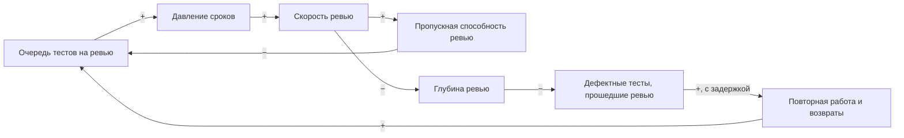

# Лабораторная работа 5. Петли обратной связи Test Writer

## Границы и статус наблюдения

Рассматривается целевой процесс Test Writer: обработка задачи, подготовка
контекста репозитория, генерация и ревью теста, запуск и передача результата
разработчику. Как отмечено в [лабораторной работе 4](4lab.md), в доступной
реализации работает только HTTP-заглушка; очереди,
генерации, ревью и возвратов на доработку в ней нет. Поэтому ниже описана
проверяемая гипотеза о возможном повторяющемся поведении целевой системы, а не
наблюдённая эксплуатационная закономерность.

В качестве неприятного повторяющегося поведения выбрано накопление очереди
тестов на проверку с последующим ростом повторной работы. Когда очередь растёт,
команда может ускорять ревью, чтобы быстрее закрывать задачи. Это снимает
симптом в краткосрочной перспективе, но при снижении глубины проверки больше
ошибок может попасть в следующие этапы и вернуться на исправление.

## Причинно-следственная диаграмма

Знак «+» означает, что переменные меняются в одном направлении; знак «−» —
что в противоположных. Связь от пропущенных дефектов к повторной работе
отложена: дефект может проявиться только при последующем запуске или
использовании теста.

## Замкнутые контуры

**B1 — балансирующая петля ускорения потока:** очередь тестов на ревью →
давление сроков → скорость ревью → пропускная способность ревью → очередь
тестов на ревью. Знаки: `+ × + × + × − = −`. При прочих равных рост очереди
побуждает ускорять ревью, а рост пропускной способности уменьшает очередь.
Это краткосрочный эффект выбранного вмешательства.

**R1 — усиливающая петля возвратов:** очередь тестов на ревью → давление
сроков → скорость ревью → глубина ревью → дефектные тесты, прошедшие ревью →
повторная работа и возвраты → очередь тестов на ревью. Знаки: `+ × + × − ×
− × + × + = +`. Два отрицательных перехода — от скорости к глубине проверки и
от глубины проверки к пропущенным дефектам — вместе дают усиливающий контур.
Возврат дефектов задержан относительно первоначального ускорения.

Таким образом, обе петли действуют одновременно: B1 может быстро уменьшить
очередь, а отложенный эффект R1 — снова её увеличить. В модели именно это
создаёт повторяющийся цикл «очередь выросла → ревью ускорили → очередь временно
спала → вернулись ошибки и доработки → очередь снова выросла».

## Архетип системы

Выбран архетип **«Исправления, дающие обратный эффект»** (*Fixes that Fail*).
Сходство: ускорение ревью — симптоматическая мера, которая сначала снижает
очередь (B1), но при уменьшении глубины проверки способна увеличить число
пропущенных дефектов и объём последующей работы (R1). Отложенное последствие
ослабляет или перевешивает первоначальное улучшение.

Это не диагноз текущего сервиса. В отличие от классического архетипа с
подтверждённым повторением, здесь нет фактической очереди, принятого решения
ускорять ревью, измерений качества или наблюдённого возвратного эффекта: API
пока заглушка. Направления причинных связей являются предположениями для
целевого процесса; например, скорость может вырасти без снижения качества,
если увеличить доступную мощность ревью. Поэтому архетип — рамка для проверки,
а не утверждение, что команда уже попала в этот цикл. В материалах проекта
нет конспекта лекции 7; используется распространённое название архетипа
*Fixes that Fail*.

## Как проверить гипотезу и когда заметят эффект

Для проверки в работающем пилоте нужны временные ряды по размеру и возрасту
очереди, времени и глубине ревью, доле возвратов, повторным исправлениям и
дефектам, обнаруженным после принятия теста. Следует сопоставлять ускорение
ревью с последующими возвратами, учитывая задержку между принятием теста и
обнаружением дефекта. Без таких данных нельзя заключить, что петли реально
проявляются или оценить их силу.

В рамках гипотезы рост очереди будет заметен в самой очереди сразу. Побочный
эффект снижения глубины ревью обнаружится позже — когда пропущенную ошибку
выявит следующий запуск, проверка или использование теста. Точный срок не
указать: процесс не развёрнут, а задержки не измерялись. Уже накопленные
задачи останутся в очереди; принятый тест или исправление могут сохраняться
дольше и потребовать отдельного последующего изменения.

## Ограничения

Диаграмма моделирует целевой процесс и не содержит количественных коэффициентов,
порогов или реальных временных задержек. Возможны другие причины роста очереди
(например, временное увеличение числа задач) и другие балансирующие меры
(например, дополнительный ресурс ревью без сокращения глубины проверки).
Перед выводом о фактическом поведении нужно собрать данные и проверить каждую
связь на пилоте.
