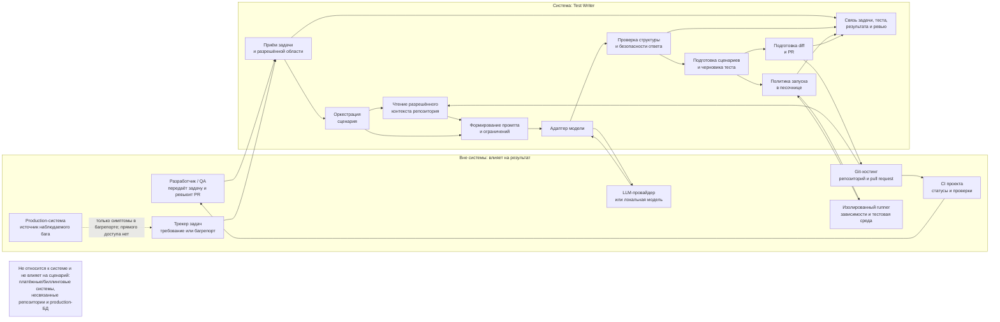

# Граница системы

## Контекст и границы

Диаграмма описывает целевую систему «Тесты по требованиям и багрепортам», а не
текущее состояние прототипа. Сейчас в репозитории работает только HTTP-заглушка;
связи с трекером, Git-хостингом, моделью и runner ещё не реализованы.

## Что внутри системы

| Часть | Ответственность системы |
| --- | --- |
| Приём задачи | Получить требование или багрепорт и явно выбранную область работы |
| Оркестрация и контекст | Управлять шагами сценария; читать только разрешённые файлы и сведения о проекте |
| Адаптер модели и промпт | Передать ограниченный контекст выбранной модели и получить ответ в заданном формате |
| Проверка результата | Проверить формат, происхождение предложений, опасные инструкции и недостающие условия |
| Подготовка и запуск теста | Сформировать diff и управлять запуском проверки через ограниченный runner; не выдавать незапущенный тест за проверенный |
| Подготовка PR и трассировка | Связать исходную задачу, diff, результаты запуска и решение ревьюера |

## Внешняя среда, которая влияет на результат

- Разработчик или QA формулирует запрос и принимает решение по PR.
- Трекер предоставляет исходное описание, но его текст считается недоверенным.
- Git-хостинг хранит репозиторий, права доступа, ветки и PR.
- LLM-провайдер или локальная модель влияет на качество, задержку, стоимость,
  доступность и правила обработки переданных данных.
- Изолированный runner предоставляет ОС, зависимости и ресурсы для тестов;
  различия окружения могут менять результат.
- CI проекта сообщает о проверках после PR. Его статус не заменяет смысловое
  ревью теста человеком.
- Production-система является источником наблюдаемого бага, но не подключается к
  Test Writer: в систему передаётся только описание, которое предоставил человек.

## Что не относится к системе

- Платёжные и биллинговые системы: продукт не проводит платежи и не управляет
  подписками. Бюджет токенов — ограничение проекта, а не интеграция с биллингом.
- Несвязанные репозитории, production-базы данных и production-логи: они не нужны
  для выбранного сценария и не должны читаться системой.
- Исправление production-кода и автоматическое слияние: это намеренно за пределами
  продукта. Результат — проверяемый человеком PR с тестом.

## Спорные элементы и принятые решения

| Элемент | Почему граница спорная | Решение и объяснение |
| --- | --- | --- |
| LLM | Модель является центральной частью поведения, но может быть внешним API или локальным runtime | Внутри — адаптер, формирование запроса и проверка ответа; конкретная модель и её инфраструктура снаружи. Так модель можно заменить, а её стоимость, доступность и правила данных остаются ограничениями среды. |
| Git-репозиторий | Система читает код и создаёт изменения, поэтому кажется частью продукта | Сам репозиторий и Git-хостинг снаружи. Внутри — выбор разрешённой области, чтение контекста и подготовка diff/PR. Система не владеет кодом проекта и не может менять файлы за пределами выбранного scope. |
| Запуск тестов | Проверка исполнения нужна для доверия к черновику, но выполняется на чужой инфраструктуре | Внутри — политика запуска, подготовка задания и интерпретация результата; конкретные контейнеры, ОС и зависимости runner снаружи. Недоверенный код запускается только в изоляции. |
| Production | Баг возникает в production и влияет на требования к тесту | Production-система не интегрирована напрямую. Входом служит переданный человеком багрепорт; система не читает production-БД, логи и секреты и не выполняет исправления в production. |
| CI | Статус CI может влиять на решение о принятии PR | CI — внешний процесс Git-хостинга. Он дополняет запуск теста, но не является частью генерации и не принимает решение о слиянии вместо человека. |
| Ревьюер | Без него тест не должен попадать в основную ветку | Человек — внешний участник процесса. Граница продукта заканчивается PR и доступными свидетельствами проверки; принятие, изменение и merge остаются решением команды. |
| Авторизация и секреты | Для чтения репозитория и создания PR нужны полномочия | Учётные записи и политика доступа принадлежат Git-хостингу/команде; минимальные scope токенов и запрет раскрывать секреты — ответственность интеграции внутри системы. Секреты не берутся из текста задачи. |

## Последствия для первой версии

1. Работа идёт только с выбранным репозиторием и явно разрешёнными файлами.
2. Модель получает минимально необходимый контекст; провайдер выбирается после
   проверки стоимости, региона и условий обработки данных.
3. Команды из задачи и сгенерированного теста не исполняются вне изолированной
   среды; production-доступа нет.
4. Система создаёт PR, но не мержит его и не меняет production-код.
5. Любая связь с внешним сервисом и каждый отказ runner должны быть видимы в
   результате, чтобы тест не обозначался как успешно проверенный без запуска.

См. также [PRD](prd.md), [итоговую картинку](brief.md) и
[черновик DoD](quality/dod-draft.md).